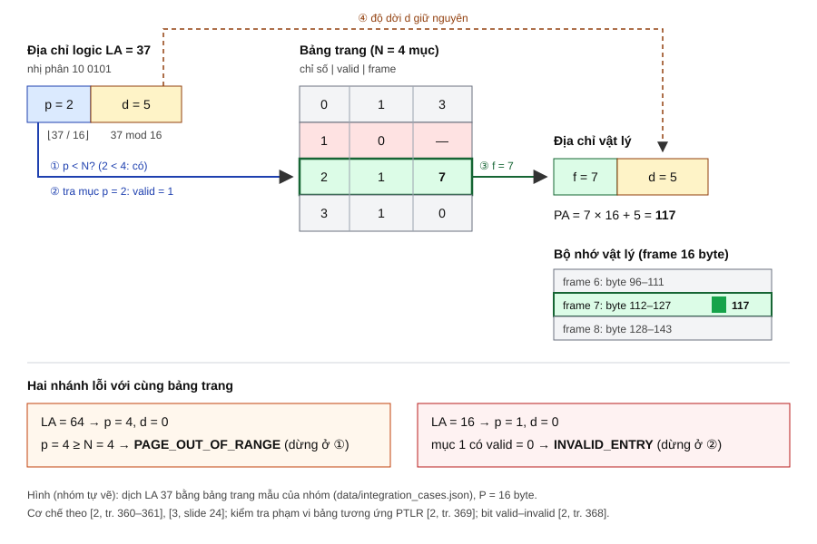

# Tài liệu Kỹ thuật — Paging and Page-Table Address Translation

> **Chủ đề:** Dịch địa chỉ qua bảng trang một cấp (Single-level Page Table Address Translation)  
> **Học phần:** Hệ điều hành — Bộ nhớ chính & Bộ nhớ ảo  
> **Tài liệu tổng hợp từ:** Đặc tả kỹ thuật, Cơ sở lý thuyết, Giải thuật mã giả, Phân tích độ phức tạp, Bảng so sánh, Giới hạn và Tài liệu tham khảo.

---

## 1. Mục tiêu & Hai câu hỏi nghiên cứu cốt lõi

Đồ án tập trung giải quyết và mô hình hóa chính xác hai câu hỏi nghiên cứu theo yêu cầu đề bài:

1. **Với bảng trang một cấp, địa chỉ logic (LA) được dịch sang địa chỉ vật lý (PA) theo quy trình gồm những bước nào?**
   - Địa chỉ logic được tách thành số trang $p$ và độ dời (offset) $d$.
   - Số trang $p$ dùng làm chỉ số tra trực tiếp vào bảng trang một cấp.
   - Nếu mục tương ứng hợp lệ (`valid == 1`), số khung trang (frame number) $f$ được lấy ra để tính địa chỉ vật lý: $\text{PA} = f \times P + d$, trong khi độ dời $d$ được giữ nguyên.
2. **Trong những trường hợp nào một địa chỉ logic bị xác định là không hợp lệ?**
   - **Địa chỉ âm hoặc sai kiểu dữ liệu:** $\text{LA} < 0$ hoặc không phải số nguyên $\to$ Mã lỗi `INVALID_ADDRESS`.
   - **Vượt phạm vi bảng trang:** Số trang $p \ge \text{len(table)}$ $\to$ Mã lỗi `PAGE_OUT_OF_RANGE` (tương ứng bẫy thanh ghi PTLR).
   - **Mục bảng trang không hợp lệ:** Trang nằm trong bảng nhưng bit `valid == 0` (chưa nạp vào RAM) $\to$ Mã lỗi `INVALID_ENTRY`.

---

## 2. Phạm vi & Giả định hệ thống

- **Đơn vị đo lường:** Mọi địa chỉ (LA, PA), kích thước trang ($P$) và độ dời ($d$) đều tính theo **byte**.
- **Kích thước trang cố định ($P$):** Chọn $P = 16\text{ bytes}$ ($2^4$) theo đề bài và giữ cố định trong toàn bộ các ca kiểm thử.
- **Quy ước đánh số:** Số thứ tự trang (`page`) và khung trang (`frame`) đều đánh số từ `0` ($0, 1, 2,\dots$).
- **Cấu trúc bảng trang mẫu:** Gồm 4 mục (từ page 0 đến page 3), tương ứng vùng địa chỉ logic hợp lệ tối đa là $0 \dots 63$:
  - `Page 0`: `valid = 1`, `frame = 3` (dải LA $0 \dots 15 \to$ PA $48 \dots 63$)
  - `Page 1`: `valid = 0`, `frame = null` (dải LA $16 \dots 31 \to$ lỗi `INVALID_ENTRY`)
  - `Page 2`: `valid = 1`, `frame = 7` (dải LA $32 \dots 47 \to$ PA $112 \dots 127$)
  - `Page 3`: `valid = 1`, `frame = 0` (dải LA $48 \dots 63 \to$ PA $0 \dots 15$)
- **Phạm vi loại trừ:** Không mô phỏng TLB, bảng trang nhiều cấp, thuật toán thay thế trang, cấp phát frame, thrashing hay giao diện đồ họa.

---

## 3. Đặc tả Giao diện & Hợp đồng Dữ liệu

Mã nguồn mô phỏng nhận lệnh CLI qua cú pháp:
```bash
python3 src/translate.py <input_cases.json>
```

### 3.1. Cấu trúc đầu vào (Input JSON)
```json
{
  "page_size": 16,
  "page_table": [
    {"valid": 1, "frame": 3},
    {"valid": 0, "frame": null},
    {"valid": 1, "frame": 7},
    {"valid": 1, "frame": 0}
  ],
  "addresses": [37, 16, 64, -1]
}
```
*Ràng buộc:* Nếu file JSON sai cú pháp, thiếu trường bắt buộc hoặc cấu hình sai kiểu, chương trình ghi `INVALID_INPUT` ra `stderr` và thoát với mã lỗi `2`.

### 3.2. Cấu trúc đầu ra (Output JSON)
Trả về danh sách kết quả tương ứng từng địa chỉ với đầy đủ trace xử lý:
```json
[
  {
    "logical_address": 37,
    "status": "ok",
    "page": 2,
    "offset": 5,
    "frame": 7,
    "physical_address": 117,
    "error": null,
    "trace": [
      {"step": "validate_address", "logical_address": 37, "passed": true},
      {"step": "split", "page_size": 16, "page": 2, "offset": 5},
      {"step": "check_page", "page": 2, "page_count": 4, "passed": true},
      {"step": "check_valid", "page": 2, "valid": 1},
      {"step": "read_frame", "frame": 7},
      {"step": "compute_pa", "frame": 7, "page_size": 16, "offset": 5, "physical_address": 117},
      {"step": "result", "status": "ok", "error": null}
    ]
  }
]
```

---

## 4. Cơ sở Lý thuyết & Sơ đồ Dịch địa chỉ

### 4.1. Công thức tính toán
Với kích thước trang $P = 2^n$ byte:
- $p = \lfloor \text{LA} / P \rfloor$ (hoặc tách các bit cao của LA)
- $d = \text{LA} \bmod P$ (hoặc tách $n$ bit thấp của LA)
- $\text{PA} = f \times P + d$ (nếu mục bảng trang hợp lệ)

### 4.2. Sơ đồ minh họa quá trình dịch địa chỉ
Dưới đây là sơ đồ trực quan hóa ca kiểm thử mẫu $\text{LA} = 37$ qua bảng trang 4 dòng:



---

## 5. Giải thuật Dịch địa chỉ & Phân tích Độ phức tạp

### 5.1. Pseudocode (Mã giả)
```text
FUNCTION TranslateAddress(logical_address, page_size, page_table):
    // Bước 1: Kiểm tra miền giá trị của địa chỉ
    IF logical_address < 0 OR logical_address IS NOT INTEGER:
        RETURN ERROR("INVALID_ADDRESS")

    // Bước 2: Tách page number và offset
    page_number = FLOOR(logical_address / page_size)
    offset = logical_address MOD page_size

    // Bước 3: Kiểm tra giới hạn bảng trang (mô phỏng PTLR)
    IF page_number >= LENGTH(page_table):
        RETURN ERROR("PAGE_OUT_OF_RANGE", page_number, offset)

    // Bước 4: Kiểm tra bit valid/invalid
    entry = page_table[page_number]
    IF entry.valid == 0:
        RETURN ERROR("INVALID_ENTRY", page_number, offset)

    // Bước 5 & 6: Lấy frame và tính physical address
    frame_number = entry.frame
    physical_address = frame_number * page_size + offset

    RETURN SUCCESS(physical_address, page_number, offset, frame_number)
END FUNCTION
```

### 5.2. Phân tích độ phức tạp thuật toán
- **Độ phức tạp thời gian (Time Complexity): $\mathcal{O}(1)$**
  - Các phép tính số học `divmod` tách $p$ và $d$ mất thời gian hằng số $\mathcal{O}(1)$.
  - Bảng trang một cấp là một mảng phẳng, việc tra cứu `page_table[page_number]` và kiểm tra bit `valid` mất $\mathcal{O}(1)$.
  - Tính $\text{PA} = f \times P + d$ mất $\mathcal{O}(1)$.
  - Đối với một tập gồm $M$ địa chỉ cần dịch, tổng thời gian xử lý là $\mathcal{O}(M)$.
- **Độ phức tạp không gian (Space Complexity): $\mathcal{O}(N)$**
  - Bảng trang một cấp cần lưu trữ toàn bộ $N$ mục của không gian địa chỉ logic (kể cả các trang chưa cấp phát có `valid = 0`), tốn $\mathcal{O}(N)$ bộ nhớ.
  - Bộ nhớ phụ trợ bổ sung cho mỗi lần dịch là $\mathcal{O}(1)$.

---

## 6. So sánh Phân trang (Paging) với Base/Limit Relocation

| Tiêu chí | Cơ chế Base/Limit Relocation | Cơ chế Phân trang một cấp (Paging) |
| :--- | :--- | :--- |
| **1. Hỗ trợ phần cứng** | Cần 2 thanh ghi trên CPU (base, limit), mạch cộng và so sánh. Không cần cấu trúc bảng trong RAM. | Cần thanh ghi PTBR trỏ tới bảng trang và PTLR kiểm tra độ dài. Bảng trang lưu trong bộ nhớ chính. |
| **2. Bố trí trên bộ nhớ vật lý** | Tiến trình bắt buộc phải chiếm một không gian **liên tục** trên RAM. | Các trang của tiến trình có thể đặt vào **khung trang bất kỳ** còn trống, không cần liên tục. |
| **3. Phân mảnh** | Gây **phân mảnh ngoài** (external fragmentation) nghiêm trọng; cần dồn bộ nhớ (compaction). | **Không có phân mảnh ngoài**. Tuy nhiên xuất hiện **phân mảnh trong** (internal fragmentation) ở khung trang cuối. |
| **4. Cơ chế bảo vệ** | Chỉ kiểm tra biên tổng thể ($\text{LA} < \text{limit}$). Một lỗi nhỏ có thể ảnh hưởng cả tiến trình. | Kiểm tra tinh tế đến từng trang thông qua bit `valid/invalid` và các quyền truy cập riêng (`r/w/x`). |
| **5. Chi phí truy cập** | Cực nhanh vì thanh ghi nằm sẵn trong CPU; mỗi truy xuất chỉ tốn **1 chu kỳ bộ nhớ**. | Chậm đi khoảng **2 lần** vì phải đọc bảng trang trong RAM trước khi đọc dữ liệu thật (nếu không có TLB). |

---

## 7. Ưu điểm & 3 Giới hạn của Bảng trang một cấp

### 7.1. Ưu điểm
1. **Loại bỏ hoàn toàn phân mảnh ngoài:** Không đòi hỏi tìm khoảng trống liên tục lớn trong RAM để nạp tiến trình.
2. **Quản lý bộ nhớ đơn giản:** Cấp phát và thu hồi theo từng đơn vị khối cố định kích thước $P$.
3. **Bảo vệ chi tiết:** Cho phép kiểm soát trạng thái cấp phát và quyền hạn trên từng trang bộ nhớ riêng biệt.

### 7.2. Ba giới hạn cốt lõi
1. **Lãng phí dung lượng lưu bảng trang khi không gian địa chỉ lớn:**
   - Trong hệ thống 32-bit với trang $4\text{ KB}$, không gian địa chỉ logic có $2^{20} \approx 10^6$ trang. Với mỗi mục 4 byte, bảng trang tốn **4 MB** cho mỗi tiến trình. Nếu tiến trình chỉ dùng vài KB, phần lớn bảng trang vẫn phải cấp phát và chứa bit `0`, gây lãng phí bộ nhớ nghiêm trọng.
2. **Giảm hiệu năng truy xuất do truy cập bộ nhớ 2 lần:**
   - Do bảng trang nằm trong bộ nhớ RAM, mỗi thao tác đọc/ghi dữ liệu thực tế đòi hỏi 2 lần truy cập bus bộ nhớ (1 lần đọc mục trang để lấy frame, 1 lần truy xuất dữ liệu thật), làm giảm tốc độ hệ thống đi 50% khi không có bộ đệm TLB.
3. **Vẫn tồn tại hiện tượng phân mảnh trong:**
   - Do bộ nhớ được cấp phát theo đơn vị nguyên vẹn từng trang, dữ liệu ở trang cuối cùng của tiến trình hiếm khi vừa khít kích thước trang. Trung bình mỗi tiến trình lãng phí $P/2$ byte bộ nhớ.

---

## 8. Danh mục Tài liệu Tham khảo

[1] Arpaci-Dusseau R.H., Arpaci-Dusseau A.C. (2023). *Operating Systems: Three Easy Pieces*, Version 1.10, Arpaci-Dusseau Books. Các chương: Ch. 15 (Address Translation), Ch. 16 (Segmentation), Ch. 18 (Paging: Introduction), Ch. 20 (Paging: Smaller Tables). Trực tuyến: https://pages.cs.wisc.edu/~remzi/OSTEP/

[2] Silberschatz A., Galvin P.B., Gagne G. (2018). *Operating System Concepts*, 10th ed., John Wiley & Sons, Inc., Hoboken NJ. Chương 9: "Main Memory" (trang 351–375).

[3] Silberschatz A., Galvin P.B., Gagne G. (2018). *Chapter 9: Main Memory*, Slide bài giảng học phần Hệ điều hành (Mã HP: 012012500102), Trường Đại học Giao thông Vận tải TP.HCM.

[4] Cox R., Kaashoek F., Morris R. (2024). *xv6: a simple, Unix-like teaching operating system*, MIT CSAIL. Chương 3: "Page tables" (trang 31–38). Trực tuyến: https://pdos.csail.mit.edu/6.1810/2024/xv6/book-riscv-rev4.pdf
