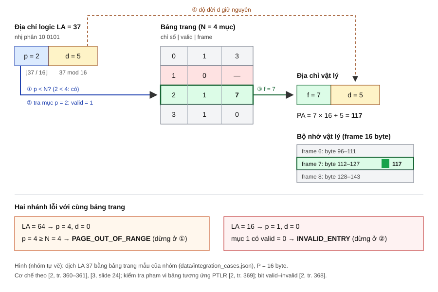

# Cơ sở lý thuyết (bản nháp của Đăng)

Chú thích trích dẫn: `[số, tr. x]` theo [references.md](references.md): [1] OSTEP, [2] Silberschatz *Operating System Concepts* 10th, [3] slide ch9 của thầy, [4] xv6 (MIT). Số thứ tự cuối cùng do Lý đánh lại theo mục "Tài liệu tham khảo" của báo cáo. Câu nào không có trích dẫn là diễn giải hoặc quy ước của nhóm, không phải của nguồn.

## 2.1 Địa chỉ logic và địa chỉ vật lý

Địa chỉ do CPU sinh ra khi chạy chương trình gọi là địa chỉ logic, còn gọi là địa chỉ ảo. Địa chỉ mà bộ nhớ chính nhìn thấy gọi là địa chỉ vật lý. Tập hợp mọi địa chỉ logic của một chương trình là không gian địa chỉ logic, tập hợp các địa chỉ vật lý tương ứng là không gian địa chỉ vật lý [2, tr. 353–354]. Việc ánh xạ từ địa chỉ logic sang địa chỉ vật lý tại thời điểm chạy do phần cứng gọi là bộ quản lý bộ nhớ (MMU) thực hiện [2, tr. 354], [3, slide 11].

Thuật ngữ dùng trong báo cáo: *logical address* = địa chỉ logic (LA), *physical address* = địa chỉ vật lý (PA).

## 2.2 Phân trang (paging)

Phân trang chia bộ nhớ vật lý thành các khối kích thước cố định gọi là **frame**, và chia bộ nhớ logic thành các khối cùng kích thước gọi là **page** [2, tr. 360], [3, slide 23], [1, ch. 18, tr. 1]. Một page được nạp vào một frame bất kỳ còn trống, nên các page của một tiến trình không cần nằm liền nhau trong bộ nhớ vật lý [2, tr. 360], [3, slide 23]. Nhờ đó phân trang không gây phân mảnh ngoài (external fragmentation) [2, tr. 360, 362], [3, slide 23], [1, ch. 18, tr. 12].

Kích thước trang do phần cứng quy định và là lũy thừa của 2 [2, tr. 361]. Giáo trình [2, tr. 361] nêu khoảng từ 4 KB đến 1 GB, trong khi slide [3, slide 23] nêu từ 512 byte đến 16 MB. Báo cáo của nhóm dùng trang rất nhỏ (P = 16 byte) chỉ để minh họa, không phản ánh kích thước thực tế.

## 2.3 Tách địa chỉ logic thành số trang và độ dời

Mỗi địa chỉ logic được tách thành hai phần: **số trang** p (page number) và **độ dời trong trang** d (page offset) [2, tr. 360], [3, slide 24]. Nếu không gian địa chỉ logic có kích thước 2^m và kích thước trang là 2^n byte, thì m − n bit cao của địa chỉ là số trang và n bit thấp là độ dời [2, tr. 361]. Ví dụ OSTEP: không gian 64 byte (6 bit), trang 16 byte (4 bit offset) nên 2 bit cao chọn trang, và địa chỉ 21 = `010101` có số trang 1, độ dời 5 [1, ch. 18, tr. 3–4].

Với số nguyên không âm, cách tách này tương đương với phép chia nguyên và phép lấy dư mà đề bài dùng (cách viết tương đương do nhóm suy ra, không trích từ nguồn):

- `page = ⌊LA / P⌋`
- `offset = LA mod P`

## 2.4 Bảng trang một cấp và phép dịch địa chỉ

Mỗi tiến trình có một bảng trang riêng [2, tr. 361], [1, ch. 18, tr. 3]. Số trang p dùng làm chỉ số để tra bảng. Mục tương ứng chứa số frame f (nguồn [2, tr. 361] mô tả là địa chỉ cơ sở của frame trong bộ nhớ vật lý) [2, tr. 361], [3, slide 24]. Phép dịch gồm các bước [2, tr. 361]:

1. Tách số trang p và độ dời d từ địa chỉ logic.
2. Dùng p để tra bảng trang, lấy số frame f.
3. Thay p bằng f; độ dời d giữ nguyên.

Vì độ dời không đổi nên địa chỉ vật lý là vị trí đầu frame cộng độ dời [2, tr. 361], [1, ch. 18, tr. 5]:

- `PA = f × P + offset`

Dạng bit tương ứng trong OSTEP: `PhysAddr = (PFN << SHIFT) | offset`, với `PTEAddr = PTBR + VPN × sizeof(PTE)` là địa chỉ của mục trang trong bộ nhớ [1, ch. 18, tr. 8–9].

**Ví dụ minh họa (P = 16 byte):**

- Ví dụ trong đề: LA = 37 → page 2, offset 5; nếu page 2 ánh xạ tới frame 7 thì PA = 7 × 16 + 5 = 117.
- Ví dụ OSTEP: bảng trang `3 7 5 2` cho 4 trang; LA 21 → page 1, offset 5, page 1 nằm ở frame 7, nên PA = 117 [1, ch. 18, tr. 3–5]. Hai ví dụ cho cùng PA 117 nhưng LA khác nhau (37 và 21), đừng nhầm lẫn khi trích.
- Ví dụ giáo trình: trang 4 byte, LA 0 → page 0, offset 0, ở frame 5 nên PA = 5 × 4 + 0 = 20; LA 4 → page 1, offset 0, ở frame 6 nên PA = 24 [2, tr. 362].

*Hình (nhóm tự vẽ): dịch LA 37 bằng bảng trang mẫu của nhóm, P = 16 byte, kèm hai nhánh lỗi LA 64 và LA 16. Cơ chế theo [2, tr. 360–361], [3, slide 24].*

## 2.5 Bit valid/invalid

Mỗi mục trong bảng trang có thể kèm một bit valid–invalid [2, tr. 368], [3, slide 35]. Bit đặt là *valid* nghĩa là trang thuộc không gian địa chỉ logic của tiến trình, tức là trang hợp lệ. Bit đặt là *invalid* nghĩa là trang không thuộc không gian địa chỉ logic của tiến trình [2, tr. 368], [3, slide 35]. Khi tiến trình truy cập một trang invalid, phần cứng báo bẫy (trap) cho hệ điều hành [2, tr. 368–369], [1, ch. 18, tr. 6]. Thuật toán truy cập bộ nhớ trong OSTEP kiểm tra `PTE.Valid == False` trước khi tạo địa chỉ vật lý, nếu sai thì phát sinh ngoại lệ [1, ch. 18, tr. 9]. Hệ điều hành xv6 cũng dùng cờ `PTE_V` cho mục đích này [4, tr. 33].

Ngoài bit valid, phần cứng có thể có thanh ghi độ dài bảng trang (PTLR) để cho biết kích thước của bảng; mỗi địa chỉ logic được so với giá trị này, nếu không hợp lệ thì gây trap [2, tr. 369], [3, slide 30, 35]. Điều này tương ứng với trường hợp "số trang nằm ngoài bảng" trong đề, tách biệt với trường hợp "mục trang có bit invalid".

Các tên lỗi `INVALID_ADDRESS`, `PAGE_OUT_OF_RANGE`, `INVALID_ENTRY` là quy ước của nhóm trong đặc tả, không phải tên của nguồn. Nguồn dùng các từ như "trap", "invalid page reference" [2, tr. 369], "exception" [4, tr. 33], "page-fault exception" [4, tr. 32], `SEGMENTATION_FAULT` [1, ch. 18, tr. 9]. Đề bài dùng "invalid/page fault". Cần thống nhất cách gọi trong báo cáo.

## 2.6 Chi phí của bảng trang trong bộ nhớ

Trong cài đặt thông thường, bảng trang nằm trong bộ nhớ chính và thanh ghi cơ sở bảng trang (PTBR) trỏ tới nó [2, tr. 365], [3, slide 30]. Vì vậy mỗi lần truy cập dữ liệu cần hai lần truy cập bộ nhớ: một lần đọc mục trang, một lần đọc dữ liệu, làm chậm đi hệ số 2 [2, tr. 366], [3, slide 30], [1, ch. 18, tr. 8–9]. Mô hình của nhóm chỉ mô phỏng phép dịch địa chỉ, không mô phỏng TLB hay thời gian truy cập.

## 2.7 Một số giới hạn liên quan (để chuyển sang mục Giới hạn)

- **Phân mảnh trong (internal fragmentation):** frame được cấp theo đơn vị nguyên, nên frame cuối của tiến trình có thể không đầy. Nếu kích thước tiến trình độc lập với kích thước trang, trung bình mất nửa trang mỗi tiến trình [2, tr. 362–363], [3, slide 23, 28]. Ví dụ trong giáo trình: trang 2048 byte, tiến trình 72766 byte cần 36 frame, lãng phí 962 byte ở frame cuối [2, tr. 362], [3, slide 28]. Chương 18 của [1] không bàn về ý này; chương 20 của [1] có nhắc (trang lớn thì phân mảnh trong tăng) [1, ch. 20, tr. 2].
- **Kích thước bảng trang:** hệ thống 32-bit, trang 4 KB có 2^20 (khoảng 1 triệu) mục; mỗi mục 4 byte thì mỗi tiến trình cần tới 4 MB chỉ cho bảng trang [2, tr. 371], [3, slide 39]. Vì vậy các hệ thống thực tế dùng bảng trang nhiều cấp, ví dụ xv6 dùng cây ba cấp để tránh lưu các phần không dùng [4, tr. 32].
- **Số lần đọc bộ nhớ:** xem mục 2.6. Phần cứng thường thêm TLB để giảm chi phí này [3, slide 30], [4, tr. 32]. TLB nằm ngoài phạm vi của đồ án.

## 2.8 So sánh ngắn với relocation (base/limit)

Bảng so sánh đầy đủ theo 5 tiêu chí nằm ở [comparison.md](comparison.md), phần giới hạn ở [limitations.md](limitations.md). Dưới đây là các căn cứ nền tảng:

- **Cơ chế base/limit:** thanh ghi relocation (base) chứa địa chỉ vật lý nhỏ nhất, thanh ghi limit chứa dải địa chỉ logic; MMU cộng giá trị relocation vào địa chỉ logic và mỗi địa chỉ phải nằm trong giới hạn [2, tr. 357], [3, slide 17], [1, ch. 15, tr. 5–7].
- **Phân mảnh ngoài:** cấp phát liên tục dẫn đến phân mảnh ngoài [2, tr. 359] (định nghĩa: [3, slide 21]); với segmentation cũng vậy, do segment có kích thước thay đổi [1, ch. 16, tr. 10]; phân trang tránh được [2, tr. 360, 362].
- **Segmentation:** mỗi segment có cặp base/bounds riêng [1, ch. 16, tr. 1–3].

---

## Ghi chú kiểm tra (bản nháp này)

- Mọi trang trích dẫn đã mở nguồn đọc lại. Riêng các trang của [2] đã cắt ra file [Silberschatz-OSC10-ch9-trang-duoc-trich.pdf](references/evidence/Silberschatz-OSC10-ch9-trang-duoc-trich.pdf) để Đăng tự mở xác nhận.
- Chỗ cần Đăng tự đọc lại vì có sắp xếp lại ý: mục 2.2 (hai khoảng kích thước trang), mục 2.5 (thuật ngữ trap/fault), ví dụ trong mục 2.4.
- Đừng chép nguyên văn dài từ nguồn vào báo cáo. Nếu trích nguyên văn thì dùng ngoặc kép và tuân theo quy tắc trích dẫn của trường (dưới 2 câu hoặc 4 dòng).
- Khai báo AI trong báo cáo: Claude Code hỗ trợ tìm đoạn, đối chiếu số trang và soạn nháp văn bản này theo yêu cầu của Đăng. Đăng chịu trách nhiệm đọc lại, đối chiếu và hiểu toàn bộ nội dung trước khi nộp.
